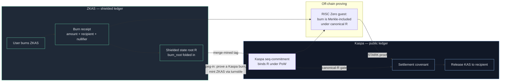

# ZKAS Bridge — trustless value transfer between Kaspa and a private ledger

> Status: reference implementation / prototype. The proving pipeline runs end‑to‑end
> (dev‑mode and with real GPU proofs); on‑chain activation waits on native settlement
> support in Kaspa (see [When](#when)). APIs and layout will change.

This repository implements a **trustless bridge** that lets value move between the public
**Kaspa** ledger and **ZKAS** — a merge‑mined, shielded‑by‑default Kaspa fork — without a
custodian, a multisig, or a trusted relayer holding funds.

It is built on top of [`kaspanet/vprogs`](https://github.com/kaspanet/vprogs), Kaspa's
reference framework for verifiable programs, and adds the ZKAS bridge layer: a shared proof
ABI, a burn‑exit prover, a canonical‑state gate, and an on‑Kaspa settlement covenant.

---

## The problem

Kaspa is a fast, PoW, UTXO DAG. With the covenants + zk‑precompiles upgrade it can now
*verify* zero‑knowledge proofs and *constrain* how a UTXO is spent — but it still has:

- **no confidentiality** — every amount and address is public, and
- **no path to move value into a private domain** and back out again without trusting an
  operator to hold the coins in the middle.

Bridges that solve this in practice are almost always custodial (a company holds the KAS) or
federated (an *m‑of‑n* set can steal or freeze). That is the single biggest security flaw in
the space, and it is the one we set out to remove.

## The solution

Two chains, one PoW.

- **ZKAS** is a Kaspa fork that is **shielded by default** (Orchard/Halo2 notes). It is
  **merge‑mined** into Kaspa, so it shares Kaspa's proof‑of‑work and settles under the same
  hashrate.
- The **bridge** never asks anyone to *hold* funds. To move value you **burn** it on the
  source side; a **zero‑knowledge proof** of that burn is verified on the destination side by
  a **covenant** (a consensus rule), which then releases/mints the mirrored value. No signer,
  no key, nobody who can run off with the money.

Global supply is conserved across the two chains by construction: exactly the value that
leaves one side is the value that becomes claimable on the other. Nothing is minted anywhere.

## How it works

Three primitives do the work:

1. **Canonical‑R.** ZKAS commits its shielded state root `R` into a Kaspa block by writing it
   into that block's merge‑mining tag. Kaspa's sequence‑commitment then binds `R` under
   Kaspa's own PoW. A covenant on Kaspa can read that commitment on‑chain — so Kaspa can
   reason about ZKAS state **trustlessly**, using nothing but buried proof‑of‑work.

2. **Burn‑exit proof (peg‑out).** When a user burns ZKAS, the burn becomes a public receipt
   folded into `R`. A RISC Zero guest proves, in zero knowledge, that a given receipt is
   Merkle‑included under a canonical, PoW‑anchored `R`. The proof reveals the payout amount
   and recipient and *nothing else*.

3. **Settlement covenant (peg‑out release / peg‑in mint).** On Kaspa, a covenant verifies that
   STARK proof through the network's zk‑precompile and checks the canonical‑R gate, then
   releases the mirrored KAS to the recipient. The reverse direction verifies a Kaspa burn
   inclusion under buried PoW and mints ZKAS through the shielded turnstile. Each exit is keyed
   by a unique nullifier, so a burn can be claimed **at most once**.



The trust assumption reduces to **"Kaspa's proof‑of‑work is honest"** — the same assumption
you already make when you use Kaspa at all. There is no additional trusted party.

## When

The design depends on Kaspa exposing, at the consensus layer:

- **zk‑precompiles** to verify Groth16 / STARK proofs on‑chain, and
- **covenants + sequence‑commitments** so a UTXO's spend can be gated on a proof and on the
  canonical state commitment.

Those primitives landed in Kaspa's covenants/zk upgrade. Against that release:

- the proving pipeline is **green end‑to‑end** — burn → proof → covenant settlement — both in
  dev mode and with **real GPU‑generated proofs**, and
- the proofs verify against **the exact verifier Kaspa runs**.

What remains before value moves on mainnet is a native on‑chain **settlement primitive** for
the covenant to pay out through. Until that is in place the peg is intentionally **kept
inactive** on the ZKAS side (no burn can be initiated), so no one can send value into a bridge
that cannot yet honour it. When the primitive ships, activation is a single switch.

## What's in this repo

This is a fork of [`kaspanet/vprogs`](https://github.com/kaspanet/vprogs). The upstream code
is the layered verifiable‑programs VM (`core/`, `storage/`, `state/`, `scheduling/`,
`transaction-runtime/`, `node/`). The **bridge layer added here** lives under `zk/`:

| Path | What it adds |
|------|--------------|
| `zk/abi/src/zkas_bridge.rs` | Shared exit‑receipt + burn‑accumulator ABI (byte‑identical to the ZKAS node) |
| `zk/abi/src/seq_commit_witness.rs`, `kaspa_hashing.rs`, `withdrawal/canonical_sink.rs` | Canonical‑R witness assembly |
| `zk/backend/risc0/zkas-burn-processor/` | Peg‑out guest: proves a burn is included under canonical `R` |
| `zk/backend/risc0/covenant/src/canonical_r_gate.rs`, `settlement.rs` | On‑Kaspa settlement covenant + canonical‑R gate |
| `zk/backend/risc0/settler/`, `test-suite/` | Settlement builder, e2e tests, and a bridge‑wallet CLI |

End‑to‑end tests: `zk/backend/risc0/test-suite/tests/zkas_bridge_e2e.rs` and
`settlement_e2e.rs`.

## Build & test

```bash
cargo build --release        # build the workspace
cargo test                   # run the test suite
cargo +nightly fmt           # format
cargo clippy --tests         # lint
```

The RISC Zero guests are prebuilt under `zk/backend/risc0/*/compiled/`. To rebuild them you
need the `risc0` toolchain (`rzup`); see `zk/backend/risc0/build-guests.sh`. Real (non‑dev)
proving additionally needs `rzup install risc0-groth16` and a CUDA GPU.

## Credits & license

The verifiable‑programs framework this builds on is
[`kaspanet/vprogs`](https://github.com/kaspanet/vprogs) by the Kaspa developers. This project
keeps their **ISC License** — see [LICENSE](LICENSE) — and adds the ZKAS bridge layer on top.
